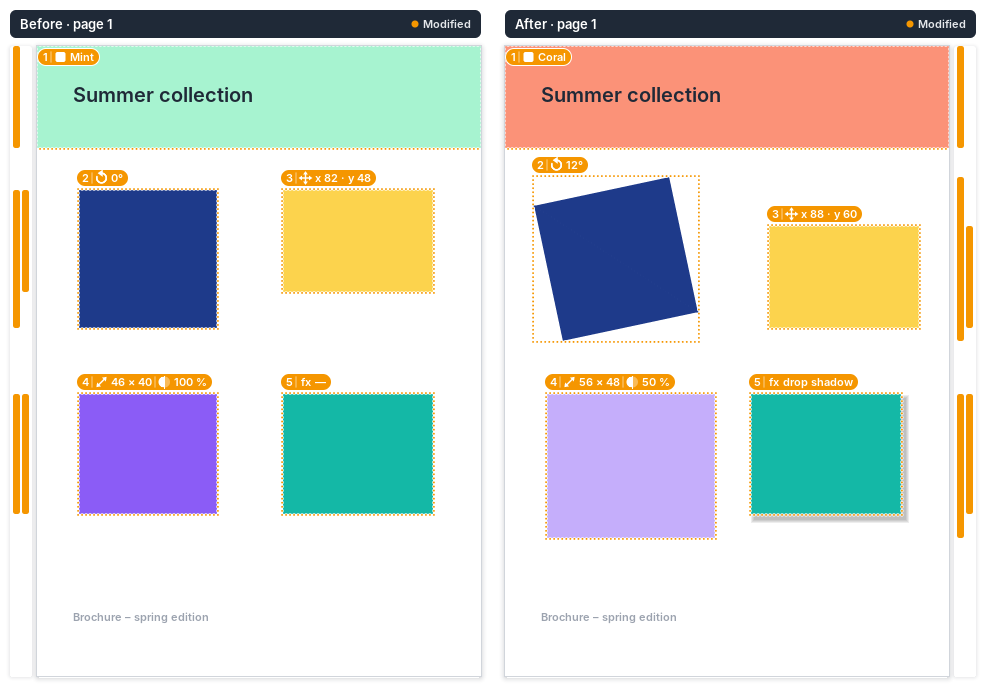
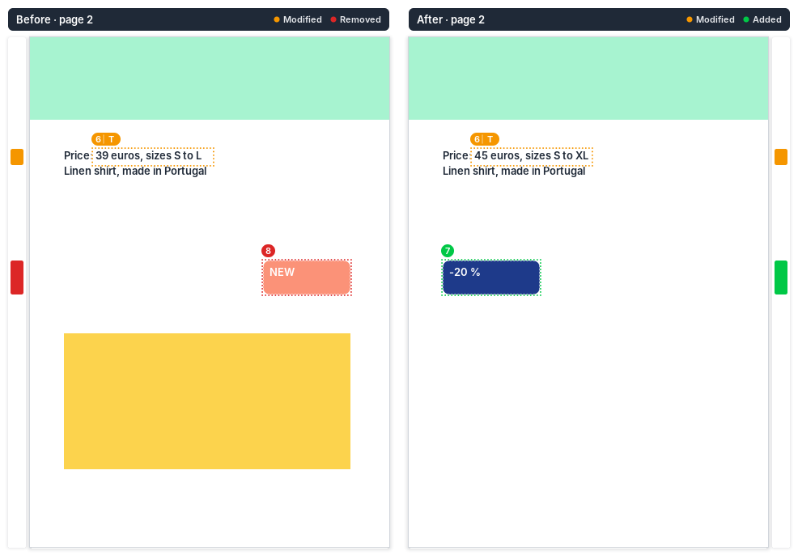
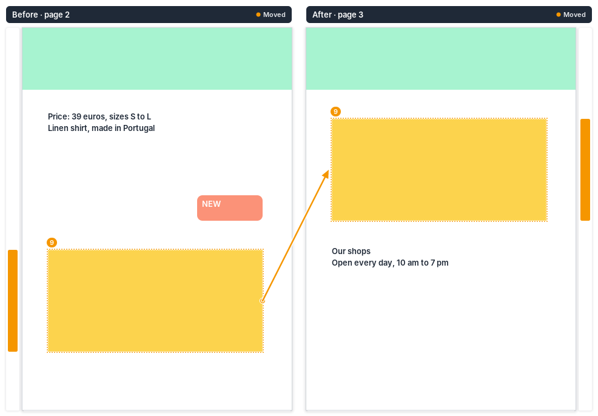
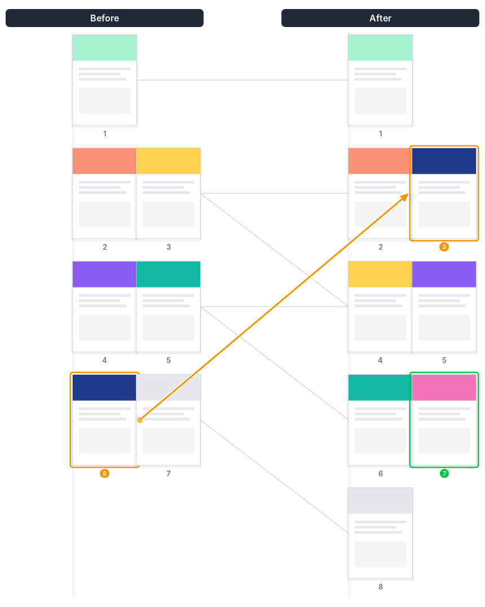

# InDesign MCP Server

**Let an AI agent work in Adobe InDesign, and see every change it made.**

Ask Claude (or any MCP client) to fix a price on page 12, to apply a client's commented PDF, or to lay out a flyer from scratch. The agent works on the open document through native InDesign objects, and finishes each task with a before/after review: what changed, where, and how to undo it.



## Why it is different

- **Surgical corrections.** The agent works only on the pages and objects of the task, addresses them by stable id, and changes only what was asked. The rest of the document stays untouched.
- **A review after every task.** The changed pages come back as BEFORE | AFTER images. Each change is a numbered zone, labelled with what happened (moved, resized, rotated, new effect, new fill, text edited) and its new value. A change table and an HTML report go with it.
- **Always a way back.** Before the first change, the document is backed up under a dated, named copy next to the file. The server never deletes a backup, and any of them can be restored.
- **Client feedback in, tasks out.** A commented PDF (notes, highlights, strike-outs, insertions) or a Word file (comments, tracked changes) becomes one numbered list. Each item is found in the document and marked as still to do or already done.
- **Real InDesign, not a picture of it.** Text uses your paragraph and character styles. Shapes are editable Bézier paths, drawn from SVG path data. Colours are CMYK swatches, converted through InDesign's own colour management.
- **The agent sees what it does.** It can render a page or a single object, measure text line by line and check for overflow, before it reports back.

## What the review looks like

Text edits are framed on the changed words. Added objects are green, removed objects red:



An object moved to another page is followed from its old page to its new one:



Pages moved, added or removed show on a page map of the whole document, spread by spread:



The table that comes with the images:

| # | Page | Element | Property | Before | After | Change |
|---:|---|---|---|---|---|---|
| 2 | 1 | Rectangle #21 «Logo» | Rotation | 0° | 12° | Modified |
| 3 | 1 | Rectangle #22 «Photo» | Position / size | x 82 · y 48 · 50 × 34 mm | x 88 · y 60 · 50 × 34 mm | Modified |
| 5 | 1 | Rectangle #24 | Effects | (none) | drop shadow | Modified |
| 6 | 2 | Text frame #31 | Text | Price: ~~39~~ euros, sizes S to ~~L~~ | Price: **45** euros, sizes S to **XL** | Modified |

## What an agent can do

More than 100 tools, grouped by job:

| | |
|---|---|
| **Corrections** | Find quoted text, replace a word inside one frame, restyle, move, resize or rotate an object by id, move objects and pages. |
| **Client files** | Read a Word or PDF brief as Markdown. Turn PDF annotations and Word comments or tracked changes into one task list. |
| **Layout** | Documents, pages of any size, text frames, Markdown with your styles, tables, layers, groups, alignment. |
| **Document frame** | A kickstart round of questions (format, bleed, margins, grid, baseline grid, numbering), then document setup, facing pages and binding, margins and columns, column and modular grids as guides, baseline grid, sections, automatic page numbers. |
| **Masters and versions** | Repeated objects found and moved to masters, overrides per page, alternate layouts for other formats or versions, compared side by side; the whole document seen from above. |
| **Typography** | Paragraph, character and object styles, leading, tracking, horizontal scale, text frame options (first baseline, auto-size, columns, own baseline grid), French typography rule by rule (no-break spaces, « », œ, ordinals, list punctuation), imported-text clean-up. |
| **Alignment** | Every reference line of a page (margins, columns, guides, baseline grid), objects snapped onto them or placed on columns and rows; the review draws the lines used. |
| **Vector graphics** | Paths from SVG data, lines, polygons, stars, rounded corners, pathfinder, gradients, opacity, overprint. |
| **Images** | Place images and graphics (SVG, PDF, AI, EPS), into frames or shapes. |
| **Colour** | CMYK, RGB and spot swatches. Hex or RGB is converted to print CMYK through the document profile, with a gamut check. |
| **Output** | PDF with presets and bleed, PNG / JPEG pages, EPUB, package, preflight, data merge. |

Every tool and parameter: [docs/TOOLS.md](docs/TOOLS.md).

## A correction, start to finish

You ask: *"Page 12: the price is now 15 €."* The agent runs:

```javascript
prepare_edit({ pages: ["12"], reason: "price p12" })   // backup + BEFORE snapshot + the page's objects with their ids
find_replace_text({ findText: "12 €", replaceText: "15 €", frameId: 4512 })
review_compare()                                      // BEFORE | AFTER images + change table, then saves the document
```

Then it shows you the review. If something is wrong, `restore_backup` brings the document back.

The agent learns this workflow from the server itself: [GUIDE.md](GUIDE.md) is served through the `get_usage_guide` tool.

## Getting started

You need:

- Adobe InDesign (the installed version is detected automatically)
- macOS or Windows
- Node.js 18+
- An MCP client: Claude Desktop, Claude Code, or another

Install:

```bash
git clone https://github.com/yo-l-an/indesign-mcp-server.git
cd indesign-mcp-server
npm install
```

Add the server to your client. For Claude Code:

```bash
claude mcp add indesign -- node /path/to/indesign-mcp-server/index.js
```

For Claude Desktop, add it to `claude_desktop_config.json`:

```json
{
  "mcpServers": {
    "indesign": {
      "command": "node",
      "args": ["/path/to/indesign-mcp-server/index.js"]
    }
  }
}
```

On Windows, write the path with escaped backslashes (`"C:\\path\\to\\indesign-mcp-server\\index.js"`).

Open InDesign and ask your agent to work on a document. On macOS, allow your client to control InDesign the first time it asks (System Settings › Privacy & Security › Automation).

### Options

Set these in the `env` block of the client configuration. All are optional.

| Variable | Effect |
|---|---|
| `INDESIGN_APP_NAME` | InDesign version to use, e.g. `Adobe InDesign 2025`, when several are installed. |
| `INDESIGN_COM_PROGID` | Windows: exact COM ProgID, e.g. `InDesign.Application.2026`. |
| `INDESIGN_BACKUP_DIR` | Folder for backups (default: `InDesign Agent Backups/` next to the document). |
| `INDESIGN_AUTO_SAVE` | `0`: the review does not save the document at the end of a task. |
| `INDESIGN_AUTO_SNAPSHOT` | `0`: no automatic backup and snapshot before the first change. |
| `INDESIGN_DEFAULT_SAVE_DIR` | Folder for documents saved without a path (default `~/Documents`). |
| `INDESIGN_ALLOWED_DIRS` | Extra folders the tools may read and write, besides your home folder and the shared folder (`:`-separated on macOS, `;` on Windows). |
| `INDESIGN_ALLOW_ARBITRARY_CODE` | `1`: enables `execute_indesign_code` (raw ExtendScript). Off by default. |

## Safety

- File paths are checked before any tool runs: only your home folder, the shared folder and the folders you allow.
- Deleting, and writing over an existing file, need an explicit confirmation from the agent.
- Arbitrary script execution is off unless you turn it on.
- Backups are never deleted by the server. Review files are temporary and cleaned up automatically.

## Documentation

- [GUIDE.md](GUIDE.md): the workflow agents follow.
- [docs/TOOLS.md](docs/TOOLS.md): units and coordinates, colour, saving, every tool, known limits.
- [docs/MANUAL-SETTINGS.md](docs/MANUAL-SETTINGS.md): the settings no tool reaches, with their menu path (French and English); agents read it through `get_usage_guide({ topic: "manual-settings" })`.
- [docs/DEVELOPMENT.md](docs/DEVELOPMENT.md): how scripts run, debugging, tests, troubleshooting.

## Contributing

Issues and pull requests are welcome. `npm run test:offline` runs the tests without InDesign, and `npm test` runs them against a live InDesign. Start with [docs/DEVELOPMENT.md](docs/DEVELOPMENT.md).

Agents that use the server can leave notes for the maintainer: bugs, missing features, better ways (`add_improvement_note`). These notes feed the next changes.

## License

MIT, see [LICENSE](LICENSE). Originally created by [lucdesign](https://github.com/lucdesign/indesign-mcp-server).

PDF files are read with [pdf.js](https://mozilla.github.io/pdf.js/) (Apache 2.0). The review images use glyphs of [Inter](https://rsms.me/inter/) by Rasmus Andersson (SIL Open Font License 1.1).
